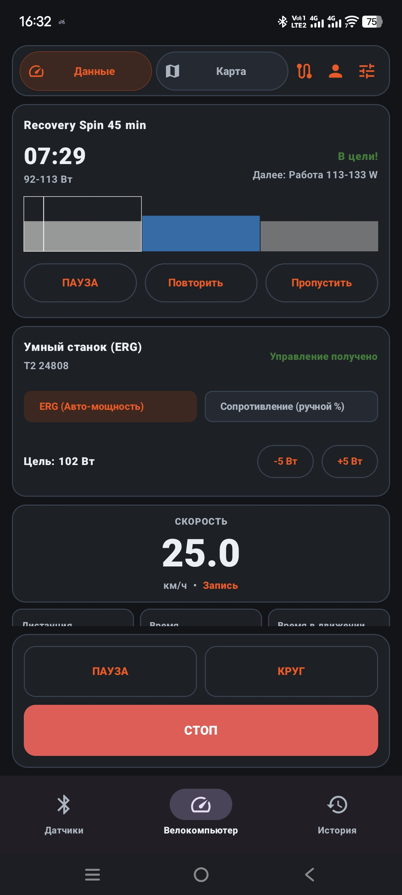
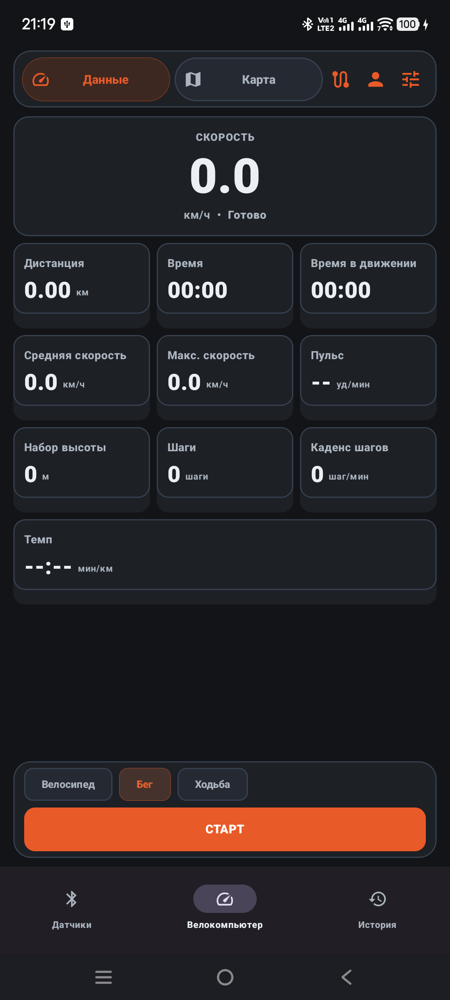
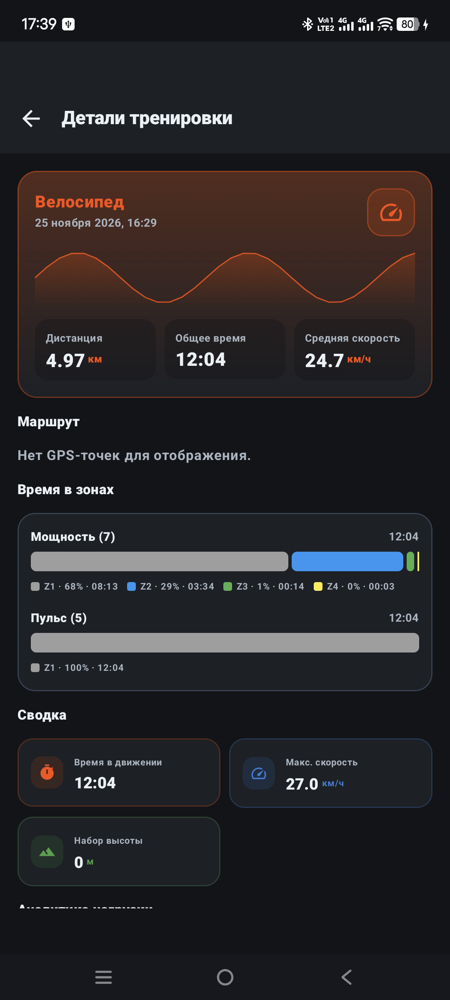
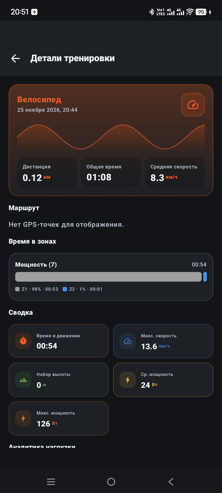

BikeGrid 1.0.10 — данные, режимы и удобство

Релиз собирает всё, что сделано после 1.0.9: мощность в статистике, автоматическое завершение тренировки по плану, новые плитки и разделение показателей по видам спорта.

## Что нового

- **Статистика тренировки:** добавлены отдельные карточки «Ср. мощность» и «Макс. мощность»; максимум теперь сохраняется в запись тренировки, а не живёт только в живых метриках.
- **Авто-завершение тренировки:** по окончании времени плана запись останавливается сама, данные сохраняются в историю и приходит уведомление «Тренировка завершена» с дистанцией и временем (звук + вибрация, переход в приложение по нажатию).
- **Экран данных:** плитки стали чуть крупнее, а все цифры — на 2 sp больше; подписи не обрезаются.
- **Разделение по режимам:** для велосипеда — каденс, мощность, средняя мощность, уклон, панель «Умный станок»; для бега и ходьбы — шаги, каденс шагов, темп, без велосипедных метрик и панели станка. Темп показывается во всех режимах.
- **Новые плитки для велосипеда:** «Ср. мощность» и «Уклон в %». Их можно включать/выключать в «Вид и настройка → Поля показателей»; для уже настроенных профилей они добавлены автоматически. Уклон считается по GPS-точкам с высотой.
- **История:** кнопки «Отправить на часы», «Создать бэкап» и «Восстановить из файла» стали компактными.
- **Локализация и CI:** русские строки дополнены, релиз по тегу `v*` публикуется автоматически, описание релиза обновляется отдельной задачей.

## Скриншоты

### Было → Стало: экран тренировки

Было — крупные кнопки занимали место, метрики были недоступны:

Стало — кнопки компактнее, все показатели доступны, экран прокручивается:

### Экран данных: крупнее плитки, крупнее цифры

### Разделение режимов: бег вместо велосипедных метрик

### История тренировок

## Установка

Скачайте приложенный APK, разрешите установку из неизвестных источников и откройте файл. Минимальная версия Android — 9 (API 28). При обновлении данные сохраняются: ключ подписи не менялся.

## Проверки релиза

- Сборка `assembleRelease` и тесты `testDebugUnitTest` в CI: успешно, 37 тестов.
- Проверено на реальном устройстве: датчики, часы, велостанок, уличный GPS, фоновая запись, обновление поверх предыдущей версии, бэкап и восстановление, новые плитки и авто-останов тренировки.
