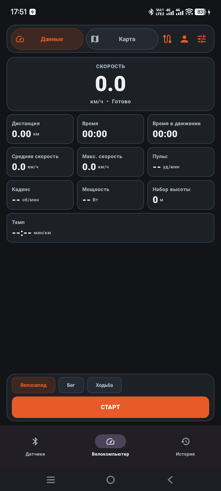
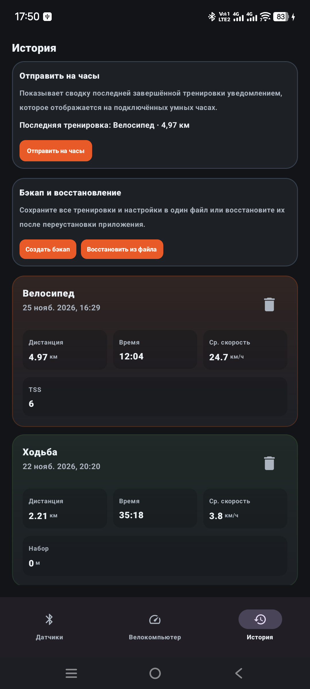

BikeGrid 1.0.9 — визуальная полировка и исправления

Этот релиз собирает все правки после 1.0.8: локализация, компактные кнопки, прокрутка экрана тренировки и полностью обновлённый экран истории.

## Что исправлено и улучшено

- **Русская локализация:** добавлены 11 недостающих строк (разрешение «Физическая активность», шаги, каденс, единицы, мощность) — теперь интерфейс целиком на русском.
- **Велокомпьютер:** вкладка «Данные» прокручивается целиком, все показатели доступны даже во время тренировки на станке; кнопки паузы/повтора/пропуска и нижней панели уменьшены.
- **Нижняя навигация:** компактнее иконки и подписи «Датчики / Велокомпьютер / История», без наложения на системные кнопки Android.
- **История тренировок:** новый hero-блок с градиентом и профилем по реальным данным, цветные карточки метрик с иконками, полосы зон с процентами и временем, карточки кругов, обновлённый блок «Аналитика нагрузки».
- **Кнопки в истории:** «Отправить на часы», «Создать бэкап» и «Восстановить из файла» стали компактными.
- **Экспорт и бэкап:** проверены GPX с реальным GPS-треком, FIT с Garmin и восстановление тренировки из JSON.
- **CI/релизы:** автоматическая публикация GitHub Release по тегу `v*`, генерация заметок из коммитов и отдельная задача обновления описания релиза.

## Было → Стало

### Экран тренировки: крупные кнопки скрывали показатели

Было — кнопки занимали много места, часть метрик была недоступна:

Стало — кнопки компактнее, все плитки видны, экран прокручивается:

### История тренировок

Компактные кнопки и карточки тренировок:

Новая шапка тренировки с профилем и крупными метриками:

Зоны, цветные карточки и аналитика нагрузки:

## Установка

Скачайте приложенный APK, разрешите установку из неизвестных источников и откройте файл. Минимальная версия Android — 9 (API 28). При обновлении данные сохраняются: ключ подписи не менялся.

## Проверки релиза

- Сборка `assembleRelease` и тесты `testDebugUnitTest` в CI: успешно, 37 тестов.
- Проверено на реальном устройстве: датчики, часы, велостанок, уличный GPS, фоновая запись, обновление поверх предыдущей версии, бэкап и восстановление.
