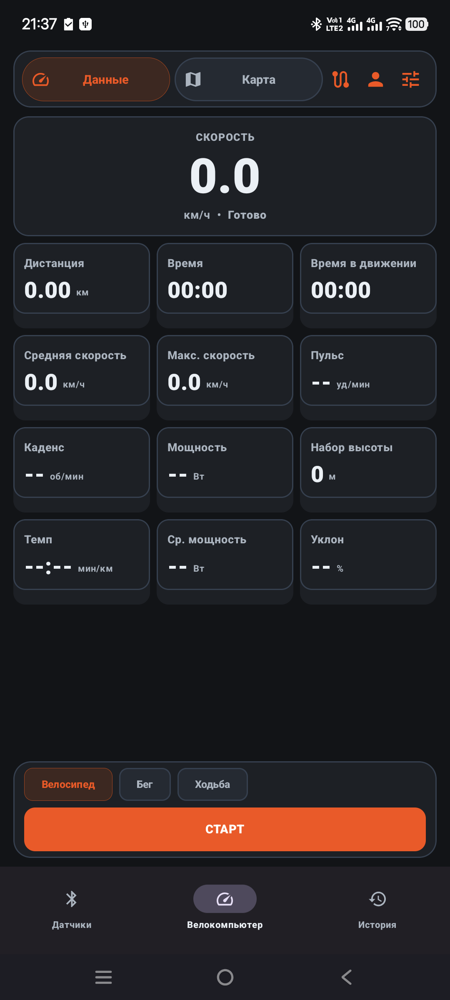

BikeGrid 1.0.11 — быстрое переподключение датчиков

Небольшое обновление после 1.0.10: ускорено автоматическое переподключение BLE-датчиков и велостанка.

## Что нового

- **BLE-ретраи:** первая попытка подключения выполняется сразу, затем с интервалом 1 секунда, максимум 5 попыток. После исчерпания попыток устройство показывается как отключённое; счётчик сбрасывается при успешном подключении.
- Ранее в 1.0.10: карточки средней и максимальной мощности в статистике, авто-завершение тренировки по плану с уведомлением, крупнее плитки и цифры на экране данных, разделение показателей по режимам, плитки «Ср. мощность» и «Уклон %», темп для велосипеда, компактные кнопки в истории и нижней навигации.

## Скриншоты

### Экран данных и режимы

### Велокомпьютер во время тренировки

### История и аналитика

## Установка

Скачайте приложенный APK, разрешите установку из неизвестных источников и откройте файл. Минимальная версия Android — 9 (API 28). При обновлении данные сохраняются: ключ подписи не менялся.

## Проверки релиза

- Сборка `assembleRelease` и тесты `testDebugUnitTest` в CI: успешно, 37 тестов.
- Проверено на устройстве: датчики, часы, велостанок, запись в фоне, обновление поверх предыдущей версии, бэкап и восстановление.
